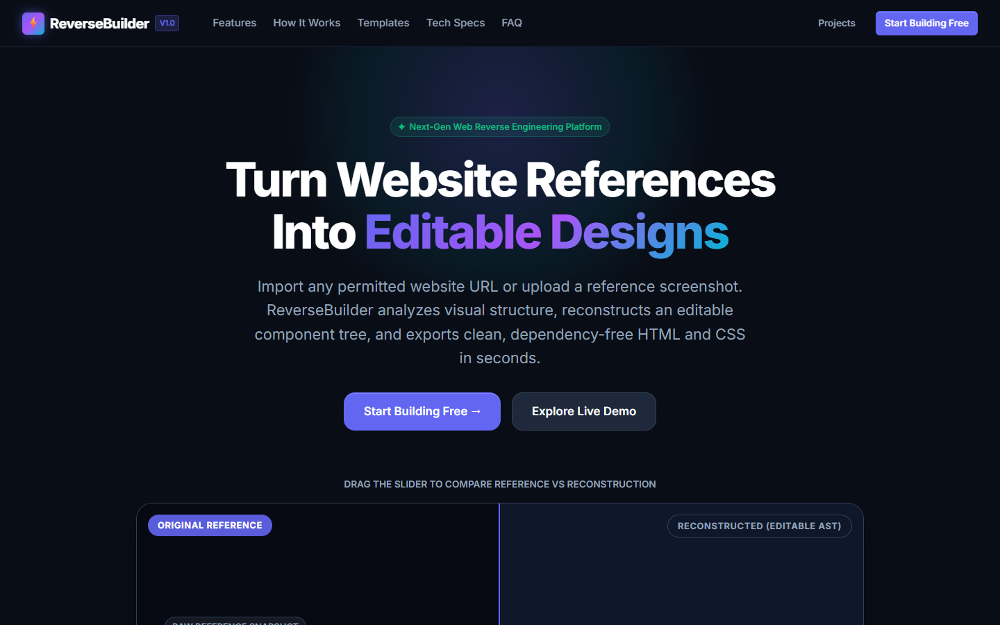
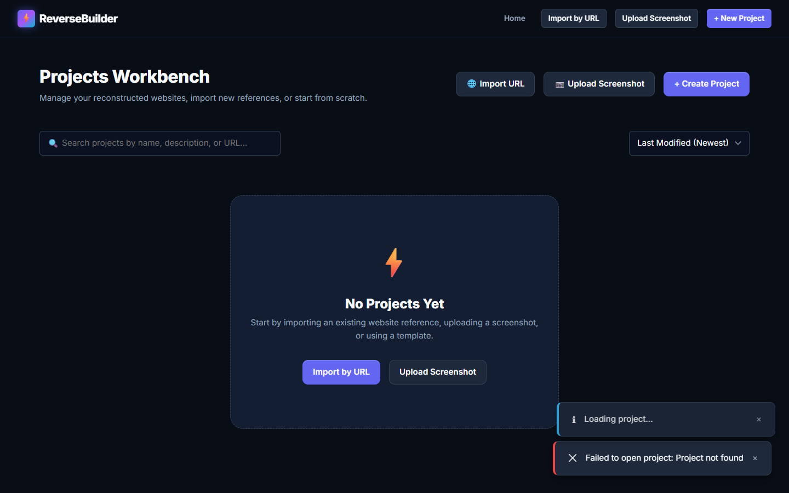
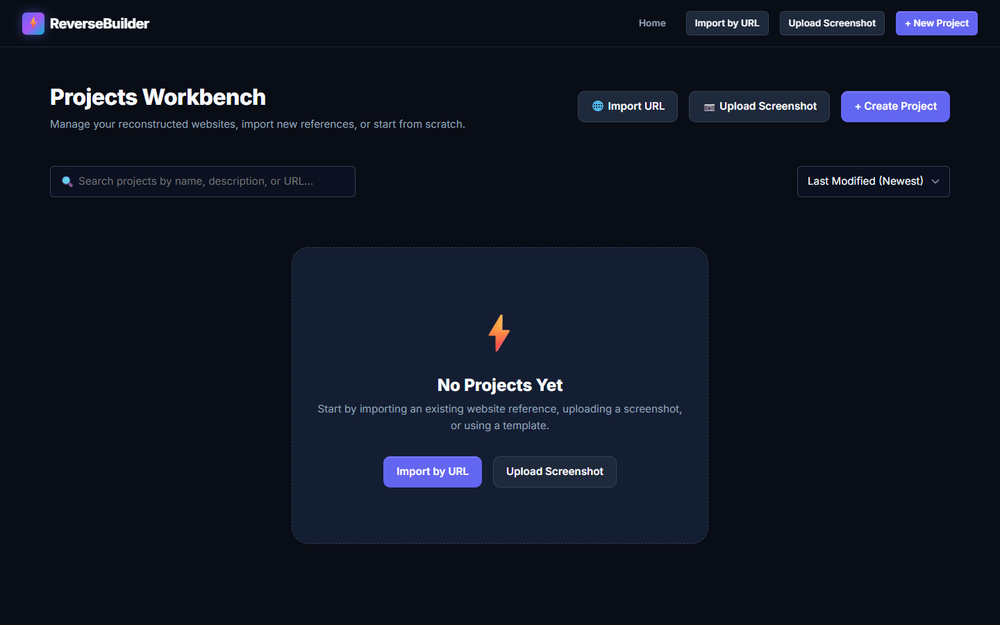

# ReverseBuilder ⚡
> **Website Reverse Engineering and Visual Rebuilding Platform**

[](https://reversebuilder.onrender.com)
[](https://github.com/hiral1609/reversebuilder-)
[](https://github.com/hiral1609/reversebuilder-)
[](LICENSE)

**ReverseBuilder** turns any website reference (URL or uploaded screenshot) into an authentic, editable visual layout. Reconstruct page typography, layout sections, brand colors, images, and content, customize them in a live visual editor, and export clean, production-ready, zero-dependency **HTML5 + CSS3 + Vanilla JavaScript**.

🌐 **Live Application**: [https://reversebuilder.onrender.com](https://reversebuilder.onrender.com)

---

## 📸 Interface Preview

### 1. Landing Page & Visual Product Showcase


### 2. Live Visual Editor & Element Property Inspector


### 3. Projects Workbench & Import Hub


---

## ✨ Key Features

### 🔍 1. Authentic URL Reverse Engineering
- **Playwright Browser Automation**: Uses headless Chromium/system browser to render JavaScript, execute SPAs, and capture authentic DOM structures and high-resolution viewport snapshots.
- **Root Container Unwrapping**: Intelligently unpacks root containers (`#root`, `#app`, `#__next`) to retain 100% of the target site's headings, search bars, navigation menus, and content blocks without dropping elements.
- **Strict SSRF Protection**: Validates every URL, blocks private subnets (`10.0.0.0/8`, `192.168.0.0/16`, `172.16.0.0/12`), loopbacks (`127.0.0.1`, `localhost`), cloud metadata endpoints (`169.254.169.254`), and non-HTTP protocols.
- **Link & Form Neutralization**: Neutralizes all links with `data-target-href` and `href="javascript:void(0);"` and disables forms in edit mode to eliminate unwanted page navigations while editing.

### 🖼️ 2. Screenshot-to-Layout Analysis
- Accepts PNG, JPEG, and WebP references up to 15MB with drag-and-drop support.
- **AI Vision Integration**: Configured for multimodal vision models (Gemini 1.5 / OpenAI) when API keys are supplied.
- **Heuristic Layout Fallback**: Automatically creates a structured, editable component scaffold even without external AI keys.

### 🎨 3. Deep Element & Section Visual Editor
- **Capture-Phase Event Interception**: Edit mode prevents native link traversal so you can freely click any text, heading, link, or image without leaving the editor.
- **Direct Inline Text Editing**: Double-click headings or text directly on the canvas for instant inline typing (`contentEditable`).
- **Comprehensive Properties Inspector**:
  - **Typography**: Select fonts (*Inter, Roboto, Poppins, Montserrat, Georgia, Code*), font size slider, and font weight (300–900).
  - **Colors & Backgrounds**: Live color pickers for text color and background color, with one-click transparent reset.
  - **Spacing & Radii**: Sliders for padding and border radius.
  - **Links & Media**: Edit link destination URLs and upload replacement images.
- **Multi-Viewport Previews**: Instant toggle between Desktop (1200px), Tablet (768px), and Mobile (375px).
- **Undo / Redo History**: Full undo/redo stack (`Ctrl+Z`, `Ctrl+Y`) with clean state management.
- **Original Reference Drawer**: Side-by-side drawer to compare your rebuild against the original website snapshot.

### 📦 4. Zero-Dependency Production Code Export
- Downloads a clean, unbundled ZIP archive containing:
  - `index.html`: Semantic HTML5 with accessibility attributes and restored `href` destinations.
  - `styles.css`: Pure responsive CSS using CSS custom properties, Flexbox, and CSS Grid. Zero frameworks or build steps.
  - `script.js`: Lightweight vanilla JS for mobile menu toggles and smooth scrolling.
  - `README.md`: Quick instructions for running locally or deploying.

---

## 🛠️ Technology Stack

| Layer | Technologies |
|---|---|
| **Frontend** | HTML5, CSS3, Vanilla JavaScript (ES6+), CSS Custom Properties, Flexbox & Grid |
| **Backend** | Node.js, Express.js, REST APIs |
| **Browser Engine** | Playwright Chromium |
| **Persistence** | Modular Atomic File Store (`server/storage/file-store.js`) |
| **Packaging** | JSZip |
| **Security** | Helmet, CORS, SSRF URL Validator, Input Sanitizers |
| **Testing** | Built-in Node.js Test Runner (`node:test`, `node:assert`) |

---

## 🚀 Getting Started

### Prerequisites
- [Node.js](https://nodejs.org/) v18.0.0 or higher
- npm v8.0.0 or higher

### Local Installation

1. **Clone the repository**:
   ```bash
   git clone https://github.com/hiral1609/reversebuilder-.git
   cd reversebuilder-
   ```

2. **Install dependencies**:
   ```bash
   npm install
   ```

3. **Install Playwright browser binaries** *(optional if Chrome or Edge is installed)*:
   ```bash
   npx playwright install chromium
   ```

4. **Environment Setup**:
   ```bash
   cp .env.example .env
   ```
   *(Optional)* Add your Gemini or OpenAI API key in `.env` if you want AI-assisted screenshot reconstruction.

5. **Start the application**:
   ```bash
   npm start
   ```

6. **Open in browser**:
   Navigate to [http://localhost:3000](http://localhost:3000)

---

## 🧪 Automated Testing

ReverseBuilder includes a complete automated test suite covering SSRF protection, AST validation, export packaging, FileStore transactions, and REST APIs:

```bash
npm test
```

```
ℹ tests 34
ℹ pass 34
ℹ fail 0
```

---

## 🌐 Cloud Deployment

ReverseBuilder is pre-configured with deployment blueprints for **Render**, **Railway**, and **Docker**.

### Deploy on Render (Free)
1. Go to [dashboard.render.com](https://dashboard.render.com) and click **New +** > **Web Service**.
2. Connect your GitHub repository: `hiral1609/reversebuilder-`.
3. Render automatically detects `render.yaml`:
   - **Runtime**: `Node`
   - **Build Command**: `npm install`
   - **Start Command**: `node server/server.js`
4. Click **Deploy Web Service**.

### Deploy with Docker
```bash
docker build -t reversebuilder .
docker run -p 3000:3000 reversebuilder
```

---

## 📁 Project Structure

```
reversebuilder/
├── client/                     # Frontend Vanilla SPA
│   ├── index.html              # Main single-page application shell
│   ├── css/                    # Responsive CSS system
│   │   ├── variables.css       # Design tokens & color variables
│   │   ├── reset.css           # Modern CSS reset
│   │   ├── layout.css          # App layouts & shells
│   │   ├── components.css      # Reusable UI components
│   │   ├── landing.css         # Landing page styles
│   │   ├── dashboard.css       # Projects dashboard styles
│   │   ├── editor.css          # Visual editor & canvas styles
│   │   └── responsive.css      # Media queries for all viewports
│   └── js/                     # Modular Vanilla JavaScript (ES6+)
│       ├── state.js            # Reactive state management
│       ├── api.js              # Fetch backend client
│       ├── router.js           # Hash-based SPA routing
│       ├── renderer.js         # Live canvas renderer & link interceptor
│       ├── inspector.js        # Deep element & section properties inspector
│       ├── history.js          # Undo / redo manager
│       ├── component-registry.js # 12 modular component schemas
│       └── app.js              # Application controller & event bindings
├── server/                     # Backend Node.js / Express
│   ├── server.js               # Application bootstrap
│   ├── config.js               # Central environment configuration
│   ├── controllers/            # Route controllers
│   ├── routes/                 # REST API routes
│   ├── services/               # Business logic
│   │   ├── crawler-service.js  # Playwright SSRF-protected crawler
│   │   ├── export-service.js   # Clean HTML/CSS/JS ZIP packager
│   │   └── reconstruction-service.js # Reconstructs AST from DOM/vision
│   ├── storage/                # File-based atomic persistence store
│   └── validators/             # Strict AST schemas & SSRF validators
├── docs/screenshots/           # High-resolution application screenshots
├── Dockerfile                  # Production container definition
├── render.yaml                 # Render cloud blueprint
└── package.json                # Project dependencies & test scripts
```

---

## 📄 License

This project is licensed under the MIT License - see the [LICENSE](LICENSE) file for details.